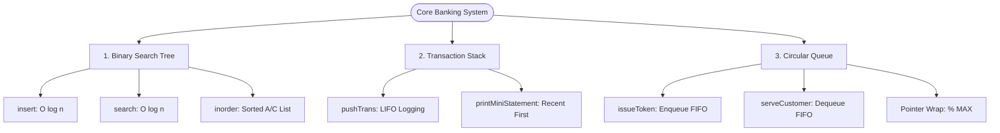

# 🏦 Core Banking Management System

[](LICENSE)
[](https://isocpp.org/)
[](#academic-context)
[](#getting-started)

> A clean, high-performance console application in C++ demonstrating real-world banking operations through fundamental data structures: **Binary Search Trees (BST)**, **Stacks (LIFO)**, and **Circular Queues (FIFO)**.

---

## 📌 Table of Contents
- [Project Overview](#-project-overview)
- [Data Structures in Action](#-data-structures-in-action)
- [System Architecture](#-system-architecture)
- [Features](#-features)
- [Project Structure](#-project-structure)
- [Getting Started](#-getting-started)
- [Sample Run & Output](#-sample-run--output)
- [Academic Context](#-academic-context)
- [Documentation & Reports](#-documentation--reports)
- [License](#-license)

---

## 📖 Project Overview

In retail banking, operations rely on efficient account indexing, rapid balance checking, audit logging, and organized customer service queues.

This project implements a lightweight core banking simulator written in **pure standard C++ (~150 lines)** without third-party libraries, highlighting raw algorithmic implementations of classic data structures taught in undergraduate Computer Science and Engineering courses.

---

## 🧠 Data Structures in Action

| Banking Feature | Data Structure Used | Practical Mapping | Why This Data Structure? |
| :--- | :--- | :--- | :--- |
| **Account Storage & Lookup** | **Binary Search Tree (BST)** | Practical 8 | Enables $O(\log n)$ average search complexity. **Inorder Traversal** (`Left -> Root -> Right`) automatically lists all accounts in ascending numerical order of Account Number. |
| **ATM Mini-Statement** | **Stack** | Practical 3 | Displays recent deposits and withdrawals in **Last-In, First-Out (LIFO)** order, ensuring the latest transaction appears at the top. |
| **Customer Token Counter** | **Circular Queue** | Practical 5B | Manages in-branch visitor traffic in strict **First-In, First-Out (FIFO)** order. Modulo arithmetic (`(rear + 1) % MAX`) reuses array memory continuously without wasting slots. |

---

## 🏗️ System Architecture



---

## ✨ Features

- **Open New Account:** Dynamically allocates memory for customer accounts and inserts into the BST.
- **Fast Account Lookup:** Search by Account Number in $O(\log n)$ time.
- **Sorted Account Directory:** Displays all customer accounts ordered by Account Number using Inorder traversal.
- **Deposit & Withdrawal:** Instant balance calculation with overdraft/insufficient balance safeguards.
- **ATM Mini-Statement:** Real-time transaction history showing recent activity first (LIFO).
- **Branch Token Line:** Interactive token dispenser and teller desk assignment using a circular queue.
- **Zero Third-Party Dependencies:** Self-contained standard C++ code.

---

## 📂 Project Structure

```text
├── bank_system.cpp      # Complete C++ source code (~155 lines)
├── Project_Report.pdf   # Complete 10-page formatted academic report (PDF)
├── Project_Report.md    # Full academic project documentation (Markdown)
├── LICENSE              # Apache License 2.0
├── .gitignore           # Ignores compiled binaries (*.exe, *.o)
└── README.md            # Repository overview & documentation
```

---

## 🚀 Getting Started

### Prerequisites
- A C++ compiler supporting C++11 or higher (`g++`, `clang++`, or MSVC).

### Compilation

Using **GCC / MinGW**:
```bash
g++ -std=c++11 bank_system.cpp -o bank_system
```

Using **Clang**:
```bash
clang++ -std=c++11 bank_system.cpp -o bank_system
```

### Execution

On **Windows**:
```cmd
bank_system.exe
```

On **Linux / macOS**:
```bash
./bank_system
```

---

## 🖥️ Sample Run & Output

```text
=== CORE BANKING SYSTEM (DS PROJECT - C++) ===
1. Open Account (BST Insert)     2. Search Account (BST Search)
3. Display All (BST Inorder)     4. Deposit Money (Stack Record)
5. Withdraw Money (Stack Record) 6. Mini-Statement (Stack LIFO)
7. Issue Token (Queue Enqueue)   8. Serve Customer (Queue Dequeue)
9. Exit
Choice (1-9): 3

--- All Bank Accounts (Sorted by A/C No) ---
A/C: 101 | Name: Ramesh | Balance: Rs. 8500
A/C: 102 | Name: Suresh | Balance: Rs. 15000
A/C: 103 | Name: Anjali | Balance: Rs. 12000
A/C: 105 | Name: Priya  | Balance: Rs. 24000

Choice (1-9): 4
Enter A/C No and Amount: 101 1500
Deposit successful! New Balance: Rs. 10000

Choice (1-9): 6
--- ATM MINI-STATEMENT (LIFO: Most Recent First) ---
[1] Deposited: Rs. 1500

Choice (1-9): 7
Token #101 issued! Please wait in customer lounge.

Choice (1-9): 8
>> Calling Token #101 to Teller Counter 1 (FIFO)
```

---

## 🎓 Academic Context

- **Course:** Data Structures (`102040304`)
- **Semester:** Semester 3 (Odd)
- **Institution:** G H Patel College of Engineering & Technology (GCET), CVM University
- **Department:** Department of Computer Engineering / Computer Science & Design Engineering

---

## 📑 Documentation & Reports

- Read the complete academic report online: [Project_Report.md](Project_Report.md)
- Download the ready-to-print PDF: [Project_Report.pdf](Project_Report.pdf)

---

## 📜 License

This project is licensed under the **Apache License 2.0** - see the [LICENSE](LICENSE) file for details.
